# دليل المستخدم: ميزانيتي الشهرية

> الإصدار 0.4.0 (beta) · يشرح هذا الدليل الموقع (واجهة الويب) ومدير الخادم، ثم يمشي معك في دورة شهر كاملة من البداية إلى النهاية.

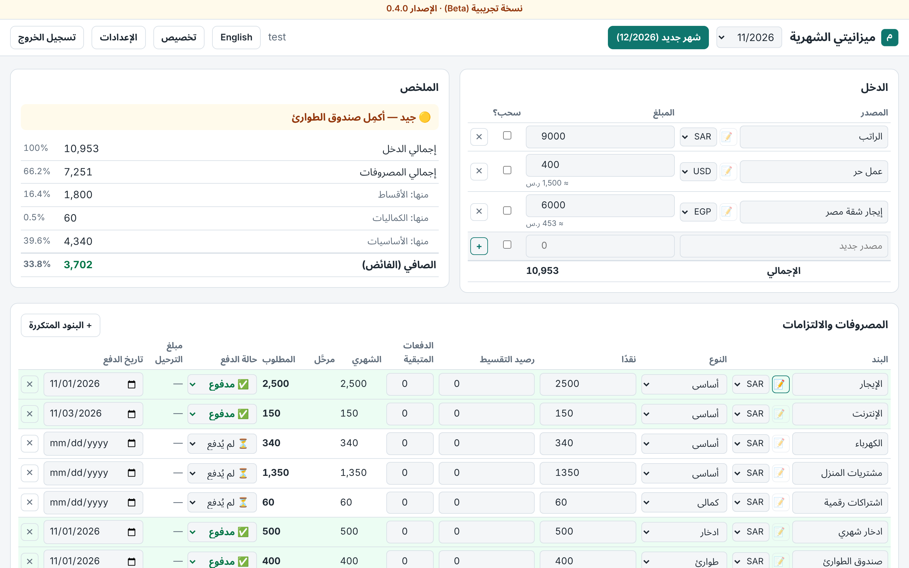

## المحتويات

1. [ما هو البرنامج؟](#1-ما-هو-البرنامج)
2. [التثبيت والتشغيل](#2-التثبيت-والتشغيل)
3. [مدير الخادم](#3-مدير-الخادم)
4. [الدخول إلى الموقع](#4-الدخول-إلى-الموقع)
5. [الداشبورد: عنصرًا عنصرًا](#5-الداشبورد-عنصرا-عنصرا)
6. [دورة شهر كاملة](#6-دورة-شهر-كاملة)
7. [الإعدادات](#7-الإعدادات)
8. [العملات وأسعار الصرف](#8-العملات-وأسعار-الصرف)
9. [تخصيص الداشبورد](#9-تخصيص-الداشبورد)
10. [النسخ الاحتياطي والاسترجاع](#10-النسخ-الاحتياطي-والاسترجاع)
11. [أسئلة شائعة وحلول](#11-أسئلة-شائعة-وحلول)

---

## 1) ما هو البرنامج؟

«ميزانيتي الشهرية» تطبيق ويب لإدارة الميزانية الشهرية، بدأ من جدول Excel ‏(`mezaniya.xlsx`) وتحوّل إلى برنامج كامل:

- **خادم صغير يعمل على حاسوبك**، وتفتح الموقع من أي متصفح على الجهاز نفسه أو من أي هاتف أو حاسوب على الشبكة المنزلية.
- **أكثر من مستخدم**، ولكل مستخدم بياناته وإعداداته المنفصلة تمامًا.
- **لغتان أصليتان (العربية والإنجليزية)**، ويمكن إضافة لغات أخرى من مدير الخادم.
- **حسابات تلقائية**: الملخص، والحالة العامة، والاقتراحات الشهرية، والتحذيرات، وصندوق الطوارئ، وتوزيع المدخرات على الأهداف.
- **ترحيل الأشهر**: كل شهر جديد يُنسخ من الشهر السابق، فتنتقل الأرصدة والأقساط والبنود المتكررة والمبالغ المرحَّلة.
- **أكثر من عملة** مع أسعار صرف لكل فترة.

البرنامج من جزأين:

| الجزء | لمن؟ | ماذا يفعل؟ |
|---|---|---|
| **مدير الخادم** | صاحب الجهاز الذي يعمل عليه البرنامج | تشغيل الخادم وإيقافه، وإدارة المستخدمين، والنسخ الاحتياطي، واللغات والنصوص |
| **الموقع** | كل مستخدم | إدخال الدخل والمصروفات والأهداف، ومتابعة الحسابات، والإعدادات الشخصية |

---

## 2) التثبيت والتشغيل

### نسخة التثبيت (Setup)

1. نزّل `Mezaniya-Setup-v<الإصدار>.exe` من صفحة [Releases](https://github.com/Abdelrahman-Elsayed-2001/Mezaniya/releases) وشغّله.
2. يُثبَّت البرنامج في `Program Files`، ويُنشأ اختصار **Mezaniya** على سطح المكتب وفي قائمة Start.
3. الاختصار يفتح **مدير الخادم**، ومنه زر **تشغيل**.

البيانات (قاعدة البيانات، والإعدادات، والنسخ الاحتياطية، والسجلات) تُحفظ في `%LOCALAPPDATA%\Mezaniya`. عند إزالة البرنامج يسألك هل تحتفظ بالبيانات أو تحذفها.

### النسخة المحمولة (Portable)

1. نزّل `Mezaniya-Portable-v<الإصدار>.zip` وفك ضغطه في مكان يمكن الكتابة فيه (سطح المكتب أو المستندات أو فلاشة)، وليس داخل `Program Files`.
2. شغّل `Mezaniya.exe`.
3. كل البيانات في مجلد `data\` بجانب البرنامج. لا تحذف الملف `portable.txt` لأنه ما يجعل النسخة محمولة.

### التشغيل من الشيفرة

يتطلب Python 3 على ويندوز. انقر نقرًا مزدوجًا على `start.bat` لتشغيل الخادم، أو على `manager.bat` لفتح مدير الخادم. في المرة الأولى يُنشئ `start.bat` بيئة `.venv` ويثبّت المكتبات.

### التحديث

- **نسخة التثبيت:** ثبّت الإصدار الجديد فوق القديم مباشرة.
- **النسخة المحمولة:** فك ضغط الإصدار الجديد ثم انسخ إليه مجلد `data\` من النسخة القديمة.

> [!NOTE]
> الإصدار 0.4.0 يقرأ بيانات 0.3.0 كما هي. أما بيانات 0.2.0 و0.1.0 فغير متوافقة؛ انظر [قاعدة بيانات من إصدار آخر](#قاعدة-بيانات-من-إصدار-آخر).

---

## 3) مدير الخادم

مدير الخادم نافذة على الحاسوب الذي يعمل عليه البرنامج. فيها تبويبان: **الخادم والمستخدمون** و**اللغات والنصوص**. رقم الإصدار يظهر في عنوان النافذة وبجوار المنفذ.

### 3.1 تبويب «الخادم والمستخدمون»

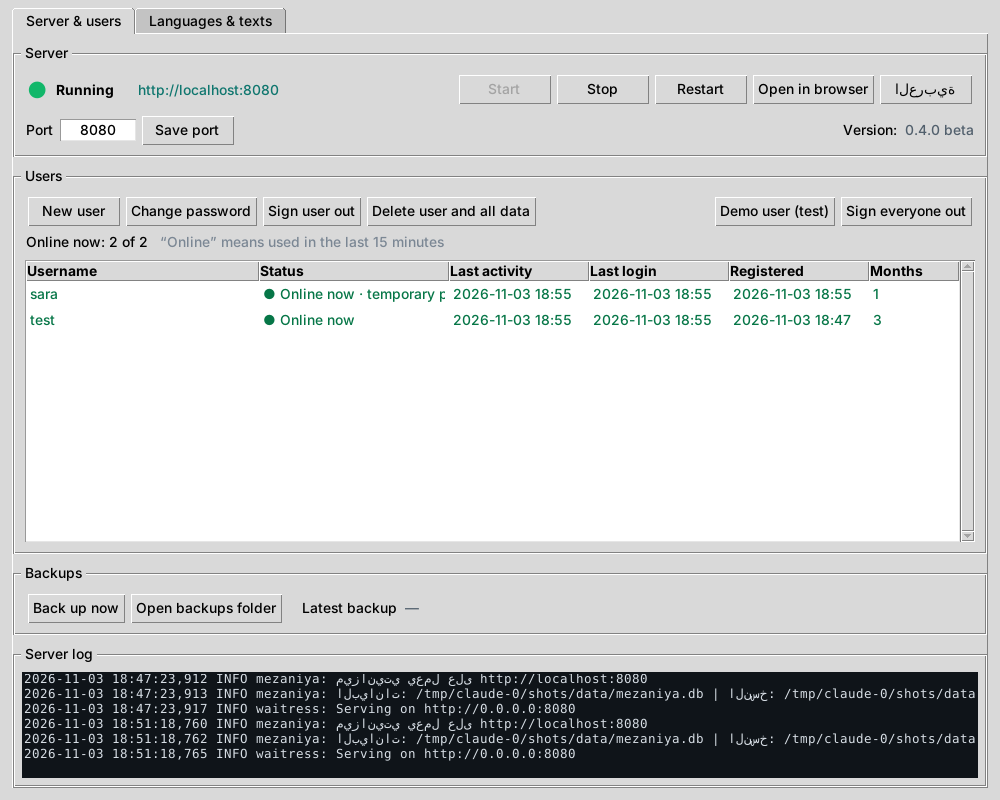

#### الخادم

| الزر أو الحقل | ماذا يفعل؟ |
|---|---|
| **تشغيل / إيقاف / إعادة التشغيل** | يتحكم في الخادم. يتعرّف المدير على الخادم سواء شُغّل منه أو من `start.bat` أو من محرر الشيفرة. |
| **الحالة والعنوان** | النقطة الخضراء تعني أن الخادم يعمل. انقر العنوان (مثل `http://localhost:8080`) لفتح الموقع. |
| **فتح في المتصفح** | يفتح الموقع في المتصفح الافتراضي. |
| **English / العربية** | يبدّل لغة المدير وينعكس اتجاه الواجهة. مع أكثر من لغتين يصبح قائمة. |
| **المنفذ ← حفظ المنفذ** | يكتب المنفذ الجديد في `mezaniya.env`، وينسخ لك أمر الجدار الناري الخاص به (الصقه في PowerShell بصلاحيات المسؤول لتتصل الأجهزة الأخرى)، ثم يعرض إعادة التشغيل. |

#### المستخدمون

| الزر | ماذا يفعل؟ |
|---|---|
| **مستخدم جديد** | ينشئ مستخدمًا باسم وكلمة مرور، حتى لو كان التسجيل من الموقع مغلقًا. |
| **تغيير كلمة المرور** | لمستخدم تختاره من الجدول (أو بالنقر المزدوج عليه). يخرج المستخدم من جميع أجهزته. |
| **إخراج المستخدم** | يخرج المستخدم المختار من جميع الأجهزة فورًا، دون إعادة تشغيل الخادم. |
| **حذف المستخدم وجميع بياناته** | يطلب كتابة اسم المستخدم للتأكيد، ويُنشئ نسخة احتياطية قبل الحذف. |
| **مستخدم تجريبي (test)** | ينشئ المستخدم `test` بكلمة المرور `test123` ومعه بيانات ثلاثة أشهر تنتهي بالشهر الحالي (أو يعيد إنشاءه). مفيد للتجربة والتعلّم. |
| **إخراج جميع المستخدمين** | يخرج الجميع من جميع الأجهزة. |

الجدول يعرض لكل مستخدم: الحالة، وآخر نشاط، وآخر دخول، وتاريخ التسجيل، وعدد الأشهر. **المتصل الآن** (بالأخضر) هو من استخدم البرنامج خلال آخر 15 دقيقة.

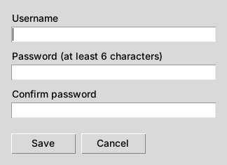

#### كلمة المرور المؤقتة

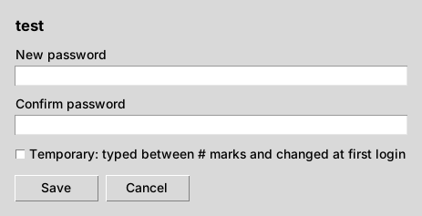

إذا نسي مستخدم كلمة مروره، عيّن له كلمة جديدة وفعّل خيار **مؤقتة**. يكتبها المستخدم عند الدخول بين علامتي `#` (مثل `#abc123#`)، فيطلب منه الموقع اختيار كلمة مرور جديدة قبل المتابعة (انظر [تغيير كلمة المرور الإجباري](#تغيير-كلمة-المرور-الإجباري)).

#### النسخ الاحتياطي وسجل الخادم

- **نسخة احتياطية الآن:** ينشئ نسخة فورية ويعرض اسمها بجوار «آخر نسخة».
- **فتح مجلد النسخ:** يفتح المجلد الذي فيه النسخ.
- **سجل الخادم:** آخر أسطر السجل، ويتحدّث تلقائيًا.

التفاصيل في [النسخ الاحتياطي والاسترجاع](#10-النسخ-الاحتياطي-والاسترجاع).

### 3.2 تبويب «اللغات والنصوص»

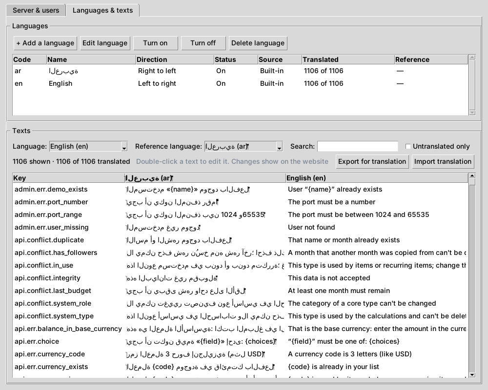

كل نص يظهر في البرنامج قابل للتعديل من هنا، وتظهر التعديلات في الموقع العامل خلال ثوانٍ دون إعادة تشغيل. تُحفظ التعديلات في `languages.db` بجانب قاعدة البيانات، وتبقى بعد تحديث البرنامج.

#### اللغات

| الزر | ماذا يفعل؟ |
|---|---|
| **+ إضافة لغة** | لغة جديدة برمزها (مثل `fr`) واسمها بلغتها واتجاه كتابتها وصيغ الجمع ولغتها المرجعية. تبدأ اللغة **متوقفة** حتى تترجمها وتفعّلها. |
| **تعديل اللغة** | يغيّر بيانات اللغة. في اللغتين الأصليتين يمكن تغيير اللغة المرجعية فقط. |
| **تفعيل / إيقاف** | اللغة المتوقفة لا تظهر في الموقع. لا يمكن إيقاف اللغة الافتراضية. |
| **حذف اللغة** | يحذف لغة مضافة وجميع نصوصها. اللغتان الأصليتان لا تُحذفان، ويمكن إيقاف الإنجليزية. |

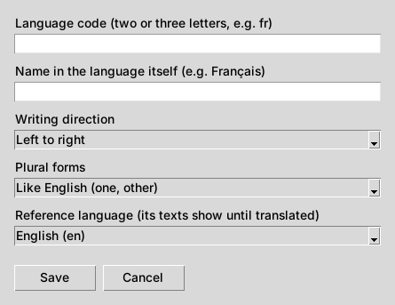

**اللغة المرجعية** هي اللغة التي تظهر نصوصها في مكان أي نص لم يُترجم بعد، فلا يظهر للمستخدم مفتاح فارغ.

#### النصوص

- اختر **اللغة** التي تعدّلها و**اللغة المرجعية** التي تقارن بها، ويمكنك **البحث** أو عرض **غير المترجَم فقط**.
- انقر نقرًا مزدوجًا على أي نص لتعديله. اترك الحقل فارغًا لاستعادة النص الأصلي.
- بعض النصوص فيها متغيرات مثل `{name}` أو `{n}`؛ يجب أن تبقى كما هي، والمدير يرفض النص الذي ينقصه متغير.

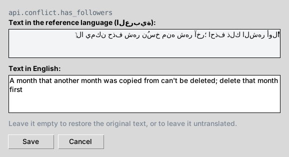

#### الترجمة بملف Excel

1. **تصدير للترجمة:** يحفظ ملف Excel ‏(xlsx) أو CSV فيه: المفتاح، والصيغة، والنص باللغة المرجعية، والنص باللغة المختارة.
2. ترجم العمود في Excel أو بأداة ذكاء اصطناعي، واحفظ الملف.
3. **استيراد ترجمة:** يقرأ الملف ويحفظ النصوص. الخلايا الفارغة تبقى على اللغة المرجعية، ويُرفض النص الذي ينقصه متغير أو الذي قرأه Excel على أنه صيغة (مثل `#NAME?`)، ويعرض المدير قائمة بما رُفض.

### قاعدة بيانات من إصدار آخر

إذا وجد المدير عند تشغيله قاعدة بيانات (`mezaniya.db` أو `languages.db`) أنشأها إصدار لا يستطيع قراءته، يعرض نافذة «تعذّر فتح البيانات» وفيها:

- **إعادة تسمية الملف والاحتفاظ به:** يصبح اسمه `mezaniya-old-v<الصيغة>-<التاريخ>.db`، ويُنشأ ملف جديد فارغ.
- **حذف الملف:** بعد تأكيد، ويُنشأ ملف جديد فارغ.
- **تحديث الملف:** يظهر فقط إذا كان في البرنامج سكربت تحديث لتلك الصيغة، ويحفظ نسخة من الملف القديم قبل التحديث.
- **إغلاق دون تغيير.**

---

## 4) الدخول إلى الموقع

افتح العنوان الذي يظهر في مدير الخادم: `http://localhost:8080` من الجهاز نفسه، أو `http://192.168.x.x:8080` من أي جهاز آخر على الشبكة.

### تسجيل الدخول وإنشاء حساب

| تسجيل الدخول | مستخدم جديد |
|---|---|
| 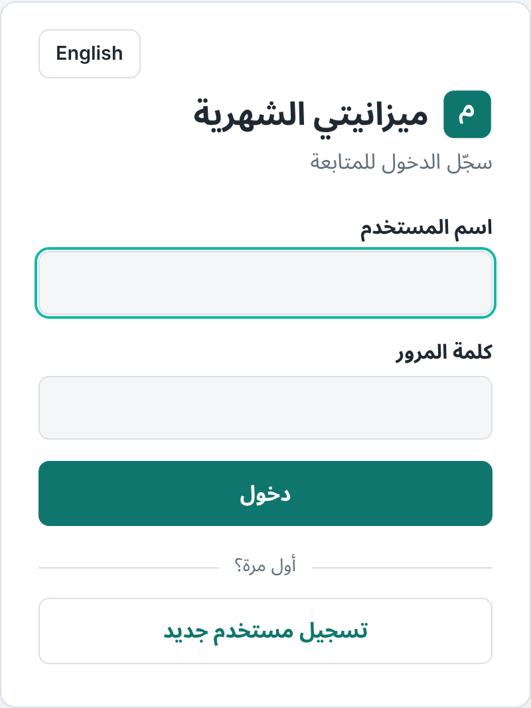 | 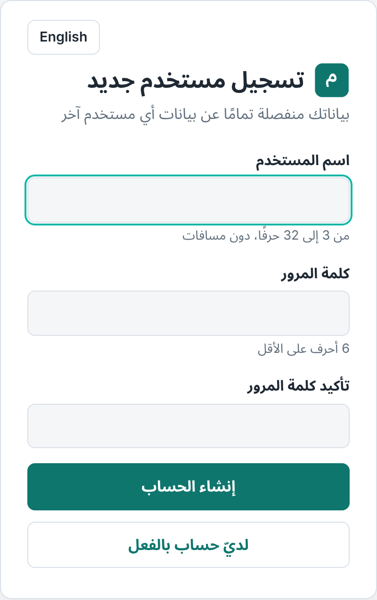 |

- في المرة الأولى اضغط **«تسجيل مستخدم جديد»**، واختر اسم مستخدم وكلمة مرور (6 أحرف على الأقل).
- بعد عدة محاولات خاطئة (5 افتراضيًا) يُقفل الاسم من ذلك الجهاز لبضع دقائق.
- يبقى الدخول صالحًا 30 يومًا افتراضيًا.
- يستطيع صاحب الخادم إغلاق التسجيل من الموقع (`MEZANIYA_ALLOW_REGISTRATION=false`)، فيُنشئ المستخدمين من مدير الخادم فقط.

عند إنشاء الحساب يُنشأ لك أول شهر (الشهر الحالي) فارغًا، ومعه أنواع المصروفات والأهداف الافتراضية بلغتك:

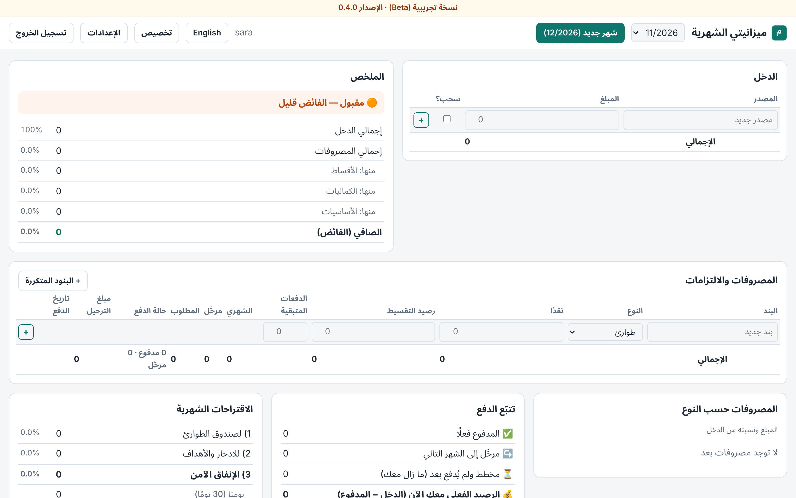

### تغيير كلمة المرور الإجباري

إذا عيّن صاحب الخادم لك كلمة مرور مؤقتة، اكتبها بين علامتي `#` عند الدخول. سيطلب منك الموقع اختيار كلمة مرور جديدة قبل أي شيء آخر:

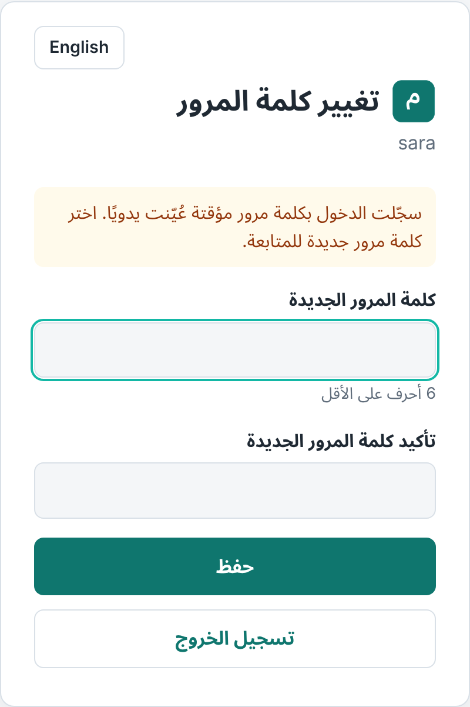

### اللغة

زر **English / العربية** في أعلى كل صفحة يبدّل اللغة لهذا المتصفح، وينقلب اتجاه الصفحة تلقائيًا. إذا فُعّلت أكثر من لغتين يصبح الزر قائمة 🌐.

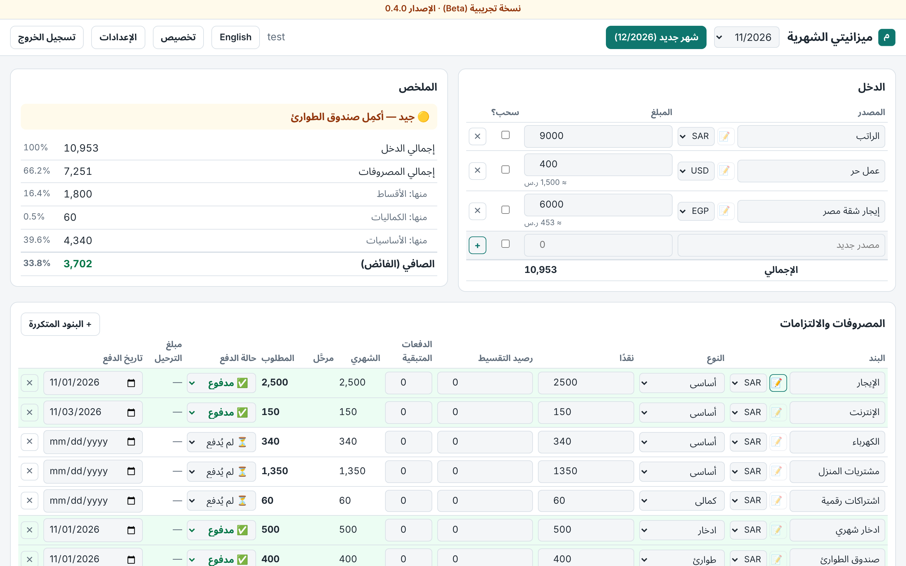

### على الهاتف

الموقع يتكيّف مع الشاشات الصغيرة: العناصر تصطف واحدًا تحت الآخر، والجداول تُمرَّر أفقيًا.

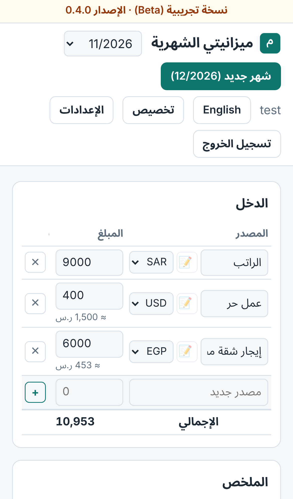

---

## 5) الداشبورد: عنصرًا عنصرًا

الداشبورد هي الصفحة الرئيسية. كل ما تكتبه فيها يُحفظ تلقائيًا عند الخروج من الحقل، وتُعاد الحسابات فورًا.

### الشريط العلوي

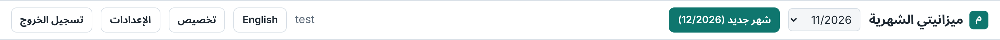

- **اختيار الشهر:** القائمة بجوار اسم البرنامج تعرض كل أشهرك.
- **شهر جديد (الشهر التالي):** يفتح نافذة إنشاء شهر جديد (انظر [نهاية الشهر](#الخطوة-5-نهاية-الشهر-وإنشاء-شهر-جديد)).
- **English:** تبديل اللغة.
- **تخصيص:** ترتيب العناصر وإنشاء داشبوردات إضافية (انظر [تخصيص الداشبورد](#9-تخصيص-الداشبورد)).
- **الإعدادات** و**تسجيل الخروج**.
- الشريط الأصفر في الأعلى يذكّرك بأنها نسخة تجريبية ويعرض رقم الإصدار.

### الدخل والملخص

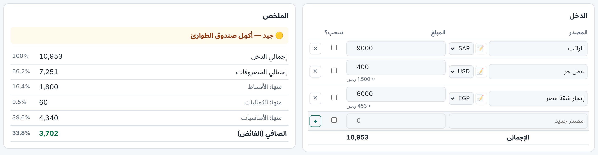

**الدخل:** لكل مصدر دخل: الاسم، والعملة، والمبلغ، وخيار **سحب؟**.
- فعّل **سحب؟** إذا كان «الدخل» في الحقيقة مبلغًا سحبته من مدخراتك؛ يُحسب في الدخل لكنه يُخصم من المدخرات، ويظهر في الحالة والتحذيرات.
- إذا كان المصدر بعملة أخرى يظهر تحته المبلغ التقريبي بالعملة الأساسية (`≈`).
- 📝 يفتح ملاحظة لهذا السطر، و✕ يحذفه، والسطر الأخير لإضافة مصدر جديد.

**الملخص:** إجمالي الدخل، وإجمالي المصروفات، ومنها الأقساط والكماليات والأساسيات، ثم **الصافي (الفائض)**، وكل رقم بنسبته من الدخل. في أعلاه **الحالة العامة**، وهي أول حالة تنطبق من هذه القائمة:

| الحالة | متى؟ |
|---|---|
| 🔴 خطر — عجز | المصروفات أكبر من الدخل |
| 🟠 ضائقة — السحب من المدخرات غطّى العجز | لولا السحب من المدخرات لكان هناك عجز |
| 🟠 انتبه — الأقساط والكماليات مرتفعة | النسبتان فوق الحدين في الإعدادات |
| 🟠 انتبه — الأقساط مرتفعة | الأقساط فوق الحد الآمن |
| 🟠 انتبه — الكماليات مرتفعة | الكماليات فوق الحد المقترح |
| 🟡 جيد — أكمِل صندوق الطوارئ | صندوق الطوارئ لم يبلغ حده الأدنى |
| 🟢 ممتاز | الفائض أعلى من نسبة «ممتاز» |
| 🟡 جيد | الفائض أعلى من نسبة «جيد» |
| 🟠 مقبول — الفائض قليل | غير ذلك |

### المصروفات والالتزامات

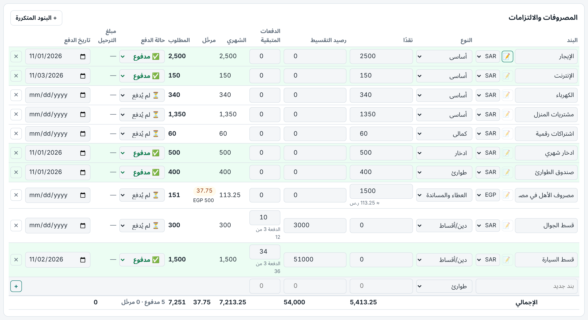

لكل بند:

| العمود | المعنى |
|---|---|
| **البند، العملة، النوع** | اسم البند وعملته ونوعه (أساسي، كمالي، دين/أقساط، ادخار، طوارئ، أو أي نوع تضيفه). النوع هو ما يحدد مكان البند في الحسابات. |
| **نقدًا** | المبلغ المدفوع مباشرة هذا الشهر. |
| **رصيد التقسيط** و**الدفعات المتبقية** | للأقساط: الرصيد المتبقي وعدد الدفعات. القسط الشهري = الرصيد ÷ عدد الدفعات، ويظهر تحته «الدفعة 3 من 12». |
| **الشهري** | نقدًا + القسط الشهري. |
| **مرحَّل** | مبلغ نُقل إلى هذا البند من الشهر السابق (للقراءة فقط). |
| **المطلوب** | الشهري + المرحَّل. |
| **حالة الدفع** | ⏳ لم يُدفع، أو ✅ مدفوع، أو ↪️ ترحيل. |
| **مبلغ الترحيل** | مع حالة «ترحيل»: المبلغ الذي ينتقل إلى الشهر التالي، ويُعدّ الباقي مدفوعًا. مثال: قسط 500 وترحيل 100 يعني أنك دفعت 400. |
| **تاريخ الدفع** | يُسجَّل تاريخ اليوم تلقائيًا عند اختيار «مدفوع» أو «ترحيل»، ويمكنك تغييره. |

- الأسطر الخضراء هي البنود المدفوعة.
- زر **+ البنود المتكررة** يضيف إلى هذا الشهر البنود المتكررة (من الإعدادات) غير الموجودة فيه.
- 📝 بجوار اسم أي بند يفتح ملاحظة خاصة به:

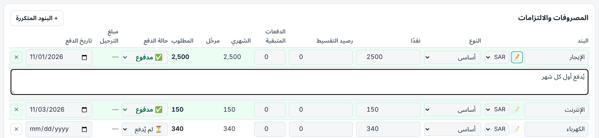

### المصروفات حسب النوع، وتتبّع الدفع، والاقتراحات الشهرية

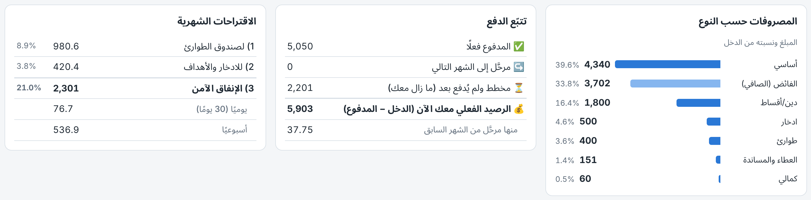

- **المصروفات حسب النوع:** رسم أفقي لكل نوع ونسبته من الدخل، ومعها الفائض.
- **تتبّع الدفع:** المدفوع فعلًا، والمرحَّل إلى الشهر التالي، والمخطط الذي لم يُدفع بعد، و**الرصيد الفعلي معك الآن** (الدخل − المدفوع).
- **الاقتراحات الشهرية:** كيف توزّع الفائض:
  1. **لصندوق الطوارئ** حتى يكتمل (بنسبة الاقتطاع في الإعدادات).
  2. **للادخار والأهداف** (بنسبة تختلف حسب اكتمال صندوق الطوارئ).
  3. **الإنفاق الآمن**: ما يبقى، ومعه ما يمكنك إنفاقه يوميًا (بعدد أيام الشهر الفعلي) وأسبوعيًا.
  
  وإذا سحبت من المدخرات ولم تنفق كل ما سحبت، يظهر سطر **↩️ أعِد إلى المدخرات**.

### التحذيرات

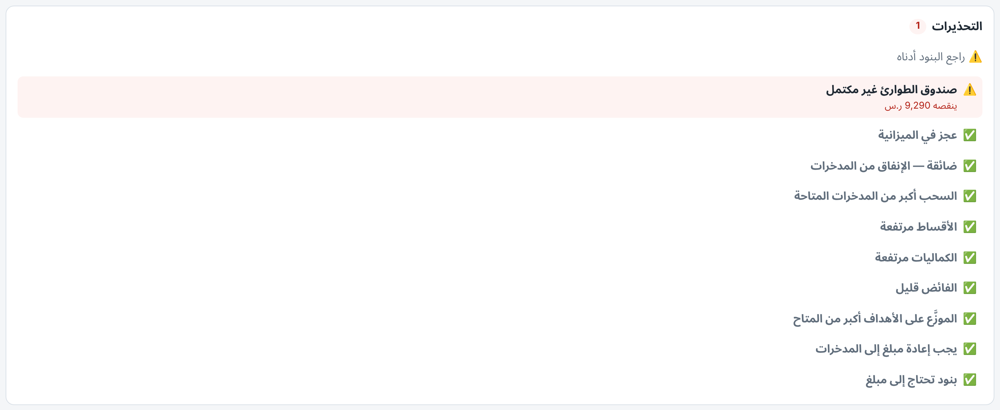

يفحص البرنامج كل شهر عشرة تحذيرات، ويعرض النشط منها في الأعلى بلون أحمر مع التفاصيل، والسليم بعلامة ✅:
عجز في الميزانية، وضائقة (الإنفاق من المدخرات)، والسحب أكبر من المدخرات المتاحة، والأقساط مرتفعة، والكماليات مرتفعة، وصندوق الطوارئ غير مكتمل، والفائض قليل، والموزَّع على الأهداف أكبر من المتاح، ويجب إعادة مبلغ إلى المدخرات، وبنود تحتاج إلى مبلغ.

### صندوق الطوارئ، والادخار، والتقدّم

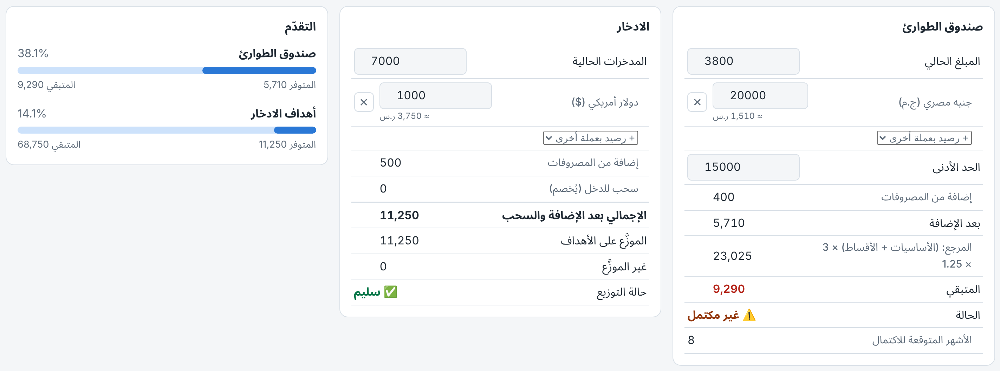

**صندوق الطوارئ:**
- **المبلغ الحالي** و**الحد الأدنى**: تكتبهما أنت.
- **+ رصيد بعملة أخرى**: مال للطوارئ تحتفظ به بعملة أخرى (مثل جنيهات نقدًا)، ويُحوَّل بسعر الشهر.
- **إضافة من المصروفات**: مجموع البنود من نوع «طوارئ» هذا الشهر.
- **المرجع**: (الأساسيات + الأقساط) × عدد الأشهر × المعامل، وهو مبلغ استرشادي يساعدك في اختيار الحد الأدنى.
- **المتبقي**، و**الحالة** (✅ مكتمل أو ⚠️ غير مكتمل)، و**الأشهر المتوقعة للاكتمال** بالاقتراح الشهري الحالي.

**الادخار:**
- **المدخرات الحالية** (ويمكن إضافة أرصدة بعملات أخرى).
- **إضافة من المصروفات** (بنود «ادخار»)، و**سحب للدخل** (يُخصم).
- **الإجمالي بعد الإضافة والسحب**، و**الموزَّع على الأهداف**، و**غير الموزَّع**، و**حالة التوزيع**.

**التقدّم:** شريطان يوضحان المتوفر والمتبقي من صندوق الطوارئ ومن أهداف الادخار.

### الأهداف

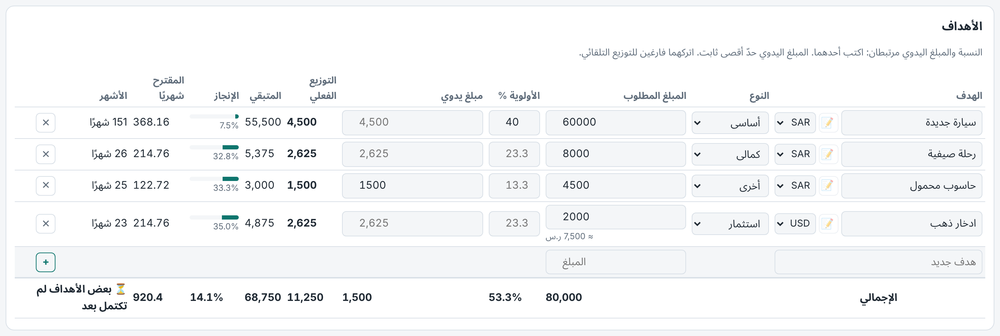

لكل هدف: الاسم، والعملة، والنوع، و**المبلغ المطلوب**، ثم طريقة التوزيع:

- **الأولوية %** و**المبلغ اليدوي** وجهان لشيء واحد: اكتب أحدهما ويُحسب الآخر.
- **المبلغ اليدوي حدّ أقصى ثابت**: لن يحصل الهدف على أكثر منه مهما زادت المدخرات.
- اتركهما فارغين ليأخذ الهدف حصة **تلقائية** مما تبقى بالتساوي مع الأهداف التلقائية الأخرى.
- إذا امتلأ هدف، يُعاد توزيع الفائض على الأهداف الباقية تلقائيًا.

ويعرض البرنامج لكل هدف: **التوزيع الفعلي**، و**المتبقي**، و**الإنجاز**، و**المقترح شهريًا** من اقتراح الادخار، و**الأشهر** المتوقعة حتى يكتمل (أو «✅ المدخرات تكفي»). الهدف الذي ليس له مبلغ مطلوب لا يدخل في التوزيع.

### الإنفاق حسب اليوم، وملاحظات الشهر

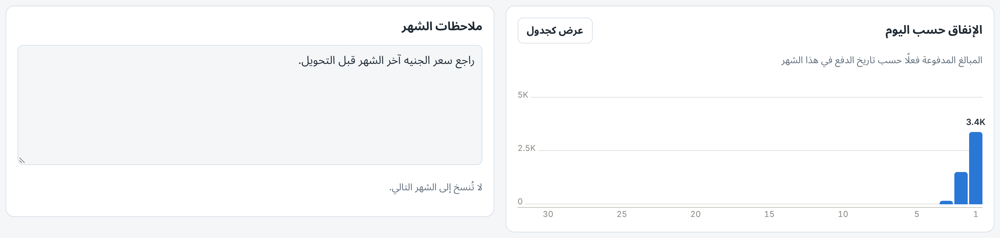

- **الإنفاق حسب اليوم:** رسم للمبالغ المدفوعة فعلًا حسب تاريخ الدفع، والزر **عرض كجدول** يعرضها أرقامًا.
- **ملاحظات الشهر:** مساحة حرة لهذا الشهر فقط، ولا تُنسخ إلى الشهر التالي.

### تفاصيل حساب الاقتراحات

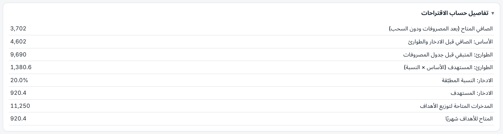

قسم مطوي يعرض الأرقام الوسيطة التي بُنيت عليها الاقتراحات: المتاح، والأساس، وفجوة الطوارئ، وهدف الطوارئ، ونسبة الادخار، وغيرها. مفيد إذا أردت أن تفهم سبب رقم معيّن.

---

## 6) دورة شهر كاملة

هذا القسم يمشي معك من أول دخول إلى بداية الشهر التالي.

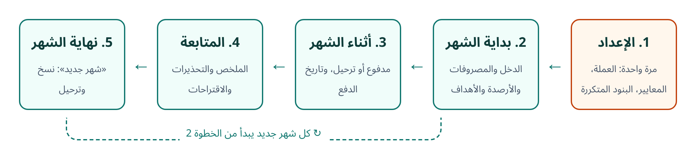

### الخطوة 1: الإعداد (مرة واحدة)

1. **أنشئ حسابك** من صفحة الدخول.
2. افتح **الإعدادات ← العملات وأسعار الصرف** واختر **العملة الأساسية** (مثل الريال السعودي)، وأضف أي عملة أخرى تتعامل بها.
3. في **الإعدادات ← المعايير** راجع النسب: متى يكون الادخار ممتازًا أو جيدًا، والحد الآمن للأقساط، والحد المقترح للكماليات، ونسب الطوارئ والادخار.
4. في **الإعدادات ← البنود المتكررة** أضف ما يتكرر كل شهر: الراتب (دخل)، والإيجار، والإنترنت، والاشتراكات... اترك المبلغ فارغًا للبنود التي يتغير سعرها (مثل الكهرباء).
5. (اختياري) أضف أنواع مصروفات أو أنواع أهداف خاصة بك، واختر ثيم الألوان من **المظهر**.

> [!TIP]
> لتتعلّم البرنامج قبل إدخال بياناتك، اطلب من صاحب الخادم إنشاء **المستخدم التجريبي** (`test` / `test123`)، وفيه ثلاثة أشهر تعرض كل المزايا.

### الخطوة 2: بداية الشهر

1. في **المصروفات** اضغط **+ البنود المتكررة** لإضافة بنودك المتكررة إلى الشهر الأول (في الأشهر التالية تُضاف تلقائيًا).
2. أكمل **الدخل**: عدّل المبالغ وأضف أي مصدر جديد.
3. أكمل **المصروفات**: اكتب سعر البنود المتغيرة (تظهر بعبارة «يحتاج إلى سعر» وفي التحذيرات)، وأضف البنود غير المتكررة.
4. للأقساط: اكتب **رصيد التقسيط** و**عدد الدفعات المتبقية** مرة واحدة، والبرنامج يحسب القسط ويُنقص الرصيد والعدد في كل شهر جديد.
5. اكتب أرصدة **صندوق الطوارئ** و**المدخرات** الحالية، والحد الأدنى للطوارئ.
6. أضف **أهدافك** بالمبالغ المطلوبة.

### الخطوة 3: أثناء الشهر

- كلما دفعت بندًا اختر **✅ مدفوع**، فيُسجَّل تاريخ اليوم ويتحوّل السطر إلى الأخضر، ويتحدّث **تتبّع الدفع** و**الإنفاق حسب اليوم**.
- إذا لم تستطع دفع بند كاملًا اختر **↪️ ترحيل** واكتب **مبلغ الترحيل**؛ ينتقل هذا الجزء إلى الشهر التالي ويُعدّ الباقي مدفوعًا.
- استخدم 📝 لتدوين ملاحظة على أي بند، و**ملاحظات الشهر** لملاحظة عامة.

### الخطوة 4: المتابعة

- راقب **الحالة العامة** في الملخص و**التحذيرات**.
- اتبع **الاقتراحات الشهرية**: كم تضع في الطوارئ، وكم تدّخر، وكم يمكنك إنفاقه يوميًا بأمان.
- تابع **التقدّم** و**الأهداف** لترى متى يكتمل كل هدف.

### الخطوة 5: نهاية الشهر وإنشاء شهر جديد

اضغط **شهر جديد (الشهر التالي)** في الشريط العلوي:

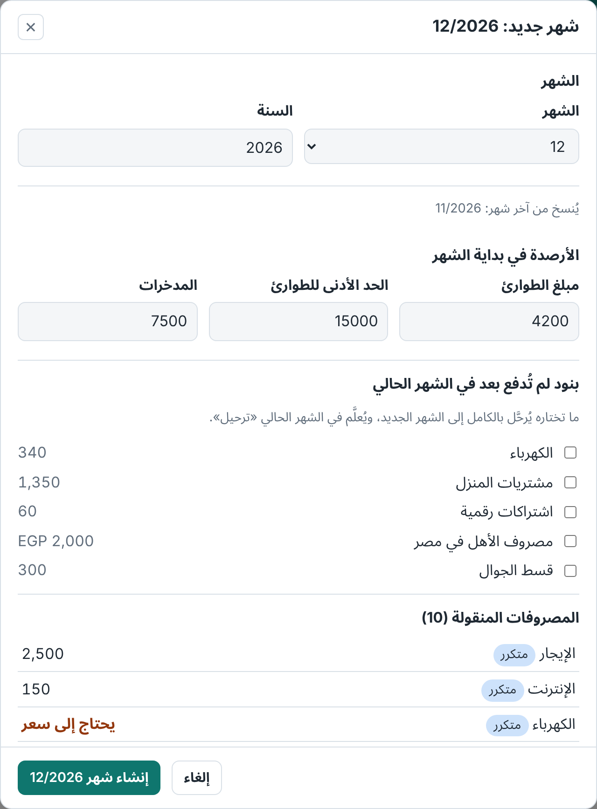

النافذة تعرض ما سيُنسخ من آخر شهر، وتسمح لك بتعديله قبل الإنشاء:

1. **الشهر والسنة**: الشهر التالي افتراضيًا.
2. **الأرصدة في بداية الشهر**: مبلغ الطوارئ والحد الأدنى والمدخرات، محسوبة من الشهر الحالي (بعد الإضافات والسحب). إذا كان هناك مبلغ يجب إعادته إلى المدخرات يظهر خيار «أعدتُ ... إلى المدخرات».
3. **بنود لم تُدفع بعد في الشهر الحالي**: اختر ما تريد ترحيله؛ يُرحَّل بالكامل إلى الشهر الجديد، ويُعلَّم في الشهر الحالي «ترحيل».
4. **المصروفات المنقولة**: كل بند مع مصدره: **متكرر** (من البنود المتكررة)، أو **تقسيط** (قسط مستمر بدفعاته المتبقية)، أو **مرحَّل** (مبلغ رُحِّل من الشهر الحالي). البنود التي تحتاج إلى سعر مُعلَّمة.
5. **الدخل المنقول** من البنود المتكررة.
6. **الأهداف**: تنتقل كلها، ويمكنك حذف الأهداف المكتملة.
7. اضغط **إنشاء شهر ...**.

> [!NOTE]
> - **شهر بعد آخر شهر** يُنسخ من آخر شهر كما سبق.
> - **شهر قبل آخر شهر** (لإدخال بيانات سابقة) يُنشأ **فارغًا دون ترحيل**، ويمكنك إضافة البنود المتكررة إليه بزر «+ البنود المتكررة».
> - يحفظ كل شهر الشهرَ الذي نُسخ منه، والترحيل يتزامن عبر هذا الربط فقط. إذا عدّلت مبلغ ترحيل في الشهر السابق يتحدّث المرحَّل في الشهر التالي.

ثم تبدأ الدورة من جديد من [الخطوة 2](#الخطوة-2-بداية-الشهر).

---

## 7) الإعدادات

افتح **الإعدادات** من الشريط العلوي. الزر **العودة إلى الميزانية** يرجعك إلى الداشبورد.

### المعايير

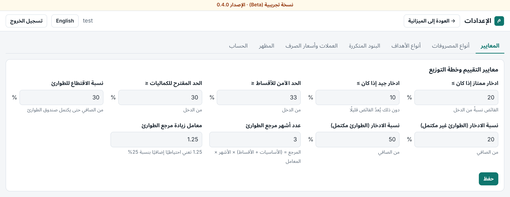

| الإعداد | الافتراضي | المعنى |
|---|---|---|
| ادخار ممتاز إذا كان ≥ | 20% | الفائض نسبةً من الدخل لتكون الحالة «ممتاز» |
| ادخار جيد إذا كان ≥ | 10% | دون ذلك يُعدّ الفائض قليلًا |
| الحد الآمن للأقساط ≤ | 33% | من الدخل |
| الحد المقترح للكماليات ≤ | 30% | من الدخل |
| نسبة الاقتطاع للطوارئ | 30% | من الصافي حتى يكتمل صندوق الطوارئ |
| نسبة الادخار (الطوارئ غير مكتمل) | 20% | من الصافي |
| نسبة الادخار (الطوارئ مكتمل) | 50% | من الصافي |
| عدد أشهر مرجع الطوارئ | 3 | في معادلة المرجع |
| معامل زيادة مرجع الطوارئ | 1.25 | يعني احتياطيًا إضافيًا بنسبة 25% |

اضغط **حفظ** بعد التعديل.

### أنواع المصروفات

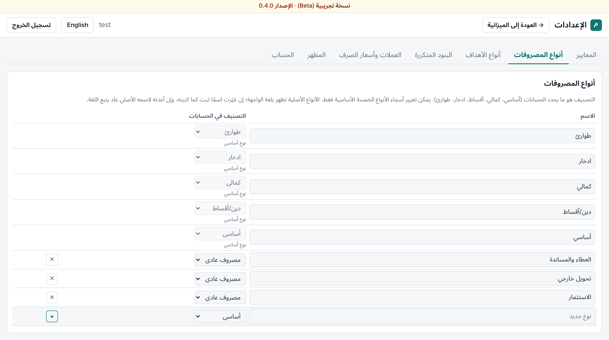

لكل نوع **تصنيف في الحسابات** (أساسي، كمالي، دين/أقساط، ادخار، طوارئ، أو مصروف عادي). التصنيف هو ما يحدد مكان البند في الملخص والطوارئ والادخار، وليس الاسم. الأنواع الخمسة الأساسية لا تُحذف ولا يتغير تصنيفها، لكن يمكن تغيير أسمائها. الأنواع الأصلية تظهر بلغة الواجهة ما لم تغيّر اسمها.

### أنواع الأهداف

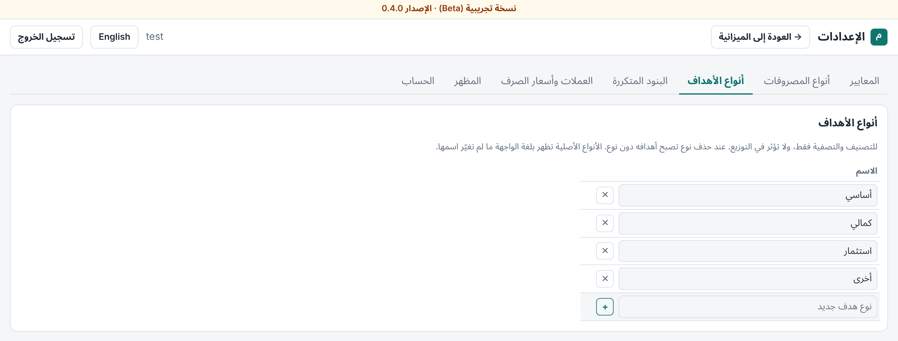

للتصنيف فقط، ولا تؤثر في التوزيع. عند حذف نوع تصبح أهدافه دون نوع.

### البنود المتكررة

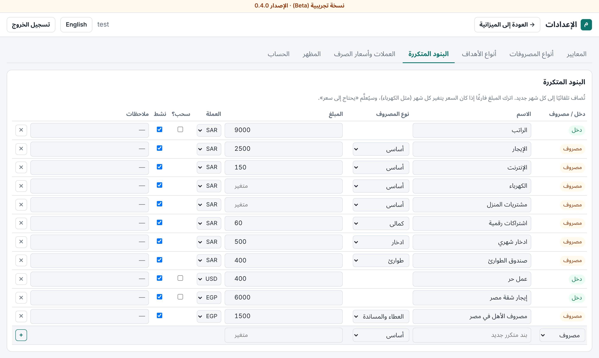

بنود دخل أو مصروف تُضاف تلقائيًا إلى كل شهر جديد. لكل بند: النوع (دخل أو مصروف)، والاسم، ونوع المصروف، والمبلغ، والعملة، و«سحب؟» للدخل، و**مفعّل**، وملاحظات. اترك المبلغ فارغًا إذا كان يتغير كل شهر، وألغِ «مفعّل» لإيقاف بند دون حذفه.

### العملات وأسعار الصرف

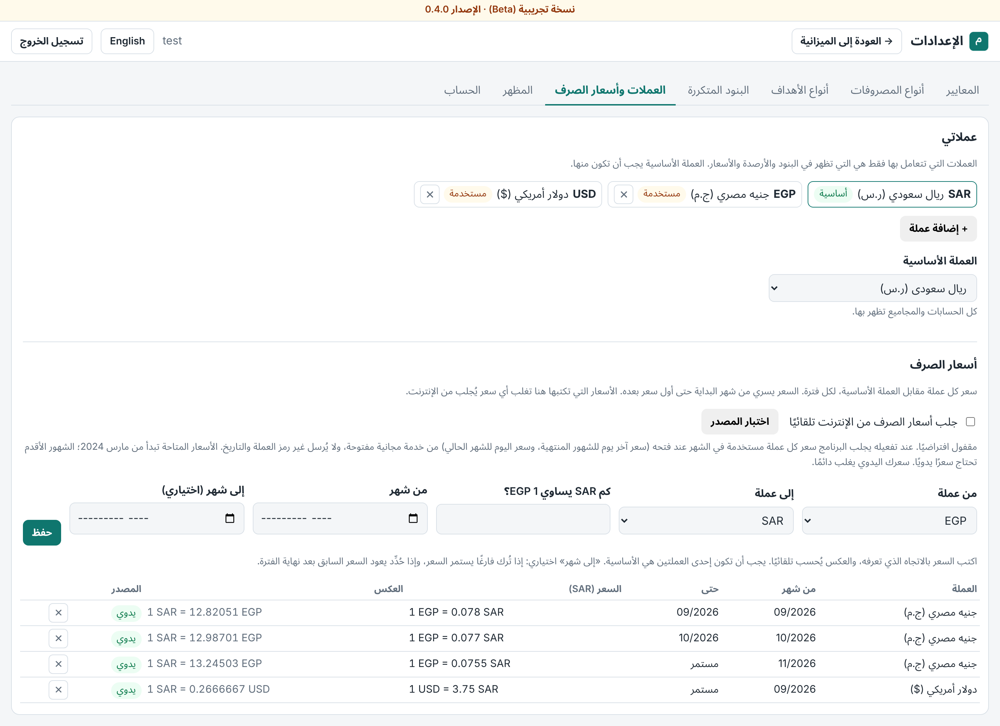

انظر [القسم 8](#8-العملات-وأسعار-الصرف).

### المظهر

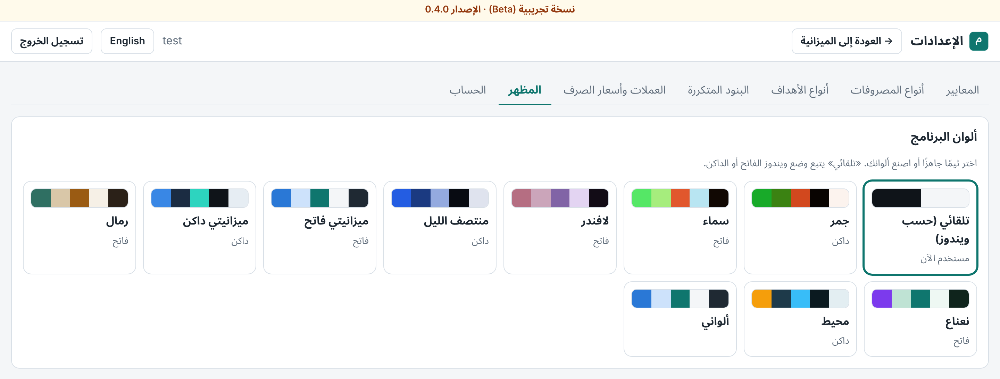

- اختر ثيمًا جاهزًا (فاتحًا أو داكنًا)، أو **تلقائي** ليتبع وضع ويندوز الفاتح أو الداكن.
- **ألوانك:** اصنع ثيمك من خمسة ألوان (النص، والخلفية، والأساسي، والثانوي، والمميز). المعاينة فورية، ولا يُحفظ شيء حتى تضغط **استخدم ألواني**.

### الحساب

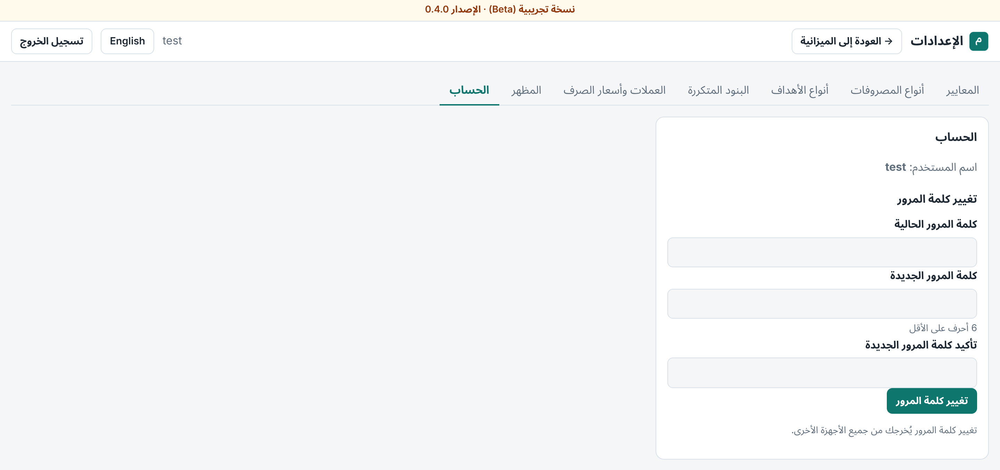

تغيير كلمة المرور: اكتب الحالية ثم الجديدة مرتين. يخرجك ذلك من الأجهزة الأخرى، ويبقى الجهاز الحالي.

---

## 8) العملات وأسعار الصرف

### العملات

- **العملة الأساسية:** كل الحسابات والمجاميع تظهر بها.
- **عملاتي:** العملات التي تتعامل بها فقط هي التي تظهر في القوائم. العملة المستخدمة في بنود تُعلَّم «مستخدمة».
- **+ إضافة عملة:** نافذة فيها كل عملات العالم (ISO 4217)، وتبحث فيها بالرمز أو بالاسم بأي لغة:

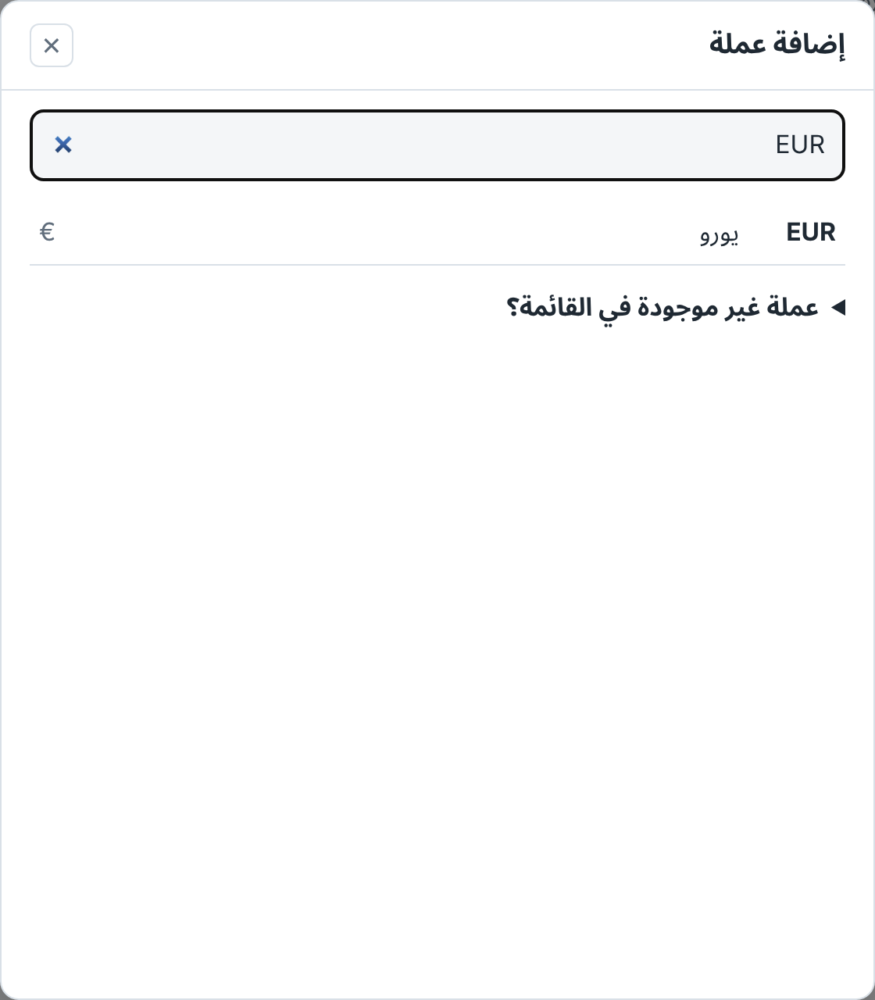

### أين تُستخدم العملات الأخرى؟

- كل سطر دخل أو مصروف أو هدف أو بند متكرر له عملة (الافتراضي هو العملة الأساسية).
- أرصدة الطوارئ والمدخرات يمكن أن تكون بعملات أخرى (**+ رصيد بعملة أخرى**).
- يظهر تحت كل مبلغ بعملة أخرى ما يساويه بالعملة الأساسية (`≈`)، ومرّر المؤشر فوقه لترى السعر المستخدم.

### أسعار الصرف

- السعر يُكتب **لفترة**: من شهر، وإلى شهر (اختياري). إذا تُرك «إلى شهر» فارغًا يستمر السعر، وإذا حُدِّد يعود السعر السابق بعد نهاية الفترة.
- اكتب السعر **بالاتجاه الذي تعرفه** (مثل 1 USD = 3.75 SAR أو 1 SAR = 12.9 EGP)، والعكس يُحسب تلقائيًا. يجب أن تكون إحدى العملتين هي الأساسية.
- **جلب أسعار الصرف من الإنترنت تلقائيًا:** مقفول افتراضيًا. عند تفعيله يجلب البرنامج سعر كل عملة مستخدمة في الشهر عند فتحه (سعر آخر يوم للأشهر المنتهية، وسعر اليوم للشهر الحالي) من خدمة مجانية مفتوحة، ولا يُرسل غير رمز العملة والتاريخ. **السعر اليدوي يغلب دائمًا.**
- **اختبار المصدر:** يجرّب الاتصال بالخدمة ويعرض الأسعار الحالية دون حفظ.
- إذا لم يوجد سعر لعملة في شهر ما، يظهر في أعلى الداشبورد تنبيه برابط لإدخال السعر، وتُحسب تلك المبالغ صفرًا حتى تُدخله.

---

## 9) تخصيص الداشبورد

اضغط **تخصيص** في الشريط العلوي:

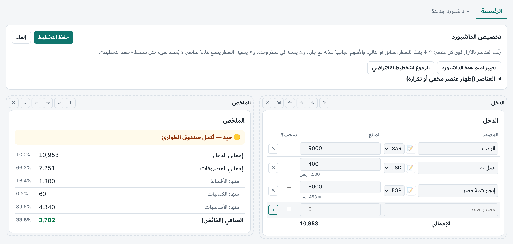

- فوق كل عنصر أزرار: **↑ ↓** لنقله إلى السطر السابق أو التالي، والأسهم الجانبية لتبديله مع جاره، و**⇲** لوضعه في سطر وحده، و**✕** لإخفائه.
- السطر الواحد يتسع لثلاثة عناصر.
- **العناصر (إظهار عنصر مخفي أو تكراره):** قائمة بكل العناصر وأين يُستخدم كل منها، والزر **إضافة لهذه الداشبورد** يضيفه في آخرها:

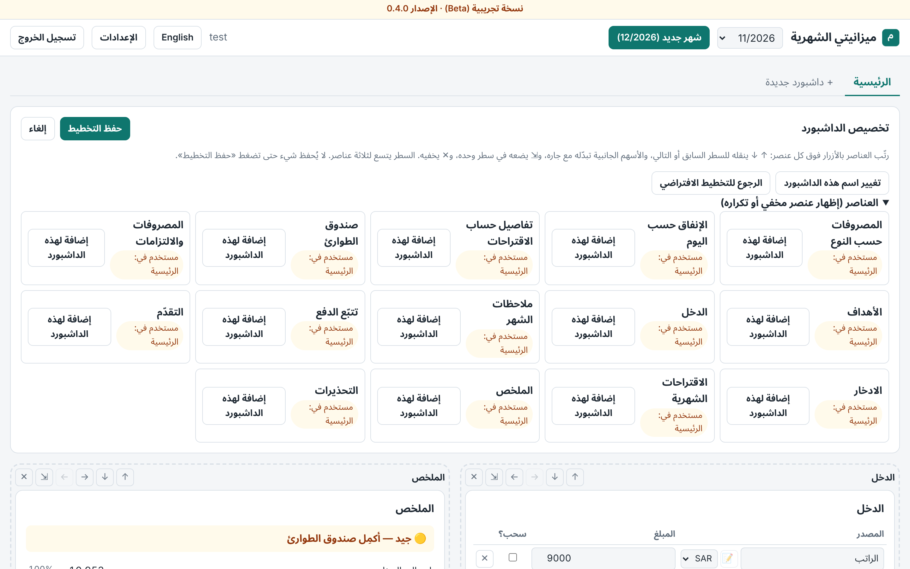

- **+ داشبورد جديدة:** أنشئ حتى 10 داشبوردات، ولكل واحدة اسم وترتيب خاص (مثل داشبورد «السفر» فيها الأهداف والعملات فقط). يمكن أن يظهر العنصر في أكثر من داشبورد، و**نسخ إلى** ينسخه إلى داشبورد أخرى.

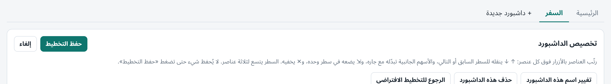

- **تغيير اسم هذه الداشبورد**، و**حذف هذه الداشبورد**، و**الرجوع للتخطيط الافتراضي**.
- لا يُحفظ شيء حتى تضغط **حفظ التخطيط**، و**إلغاء** يتجاهل كل التغييرات.

---

## 10) النسخ الاحتياطي والاسترجاع

- **تلقائيًا:** نسخة كل 24 ساعة، ويُحتفظ بآخر 14 نسخة (يمكن تغيير ذلك في `mezaniya.env`: ‏`MEZANIYA_BACKUP_INTERVAL_HOURS` و`MEZANIYA_BACKUP_KEEP`).
- **يدويًا:** زر **نسخة احتياطية الآن** في مدير الخادم، أو الأمر `manage.py backup`.
- كل نسخة تشمل قاعدة البيانات، ومعها `languages.db` (اللغات والنصوص المعدّلة).
- قبل حذف أي مستخدم تُنشأ نسخة تلقائيًا.

**الاسترجاع** (والخادم متوقف):

```bash
.venv\Scripts\python.exe manage.py list-backups
.venv\Scripts\python.exe manage.py restore <ملف-النسخة> --yes
```

يسألك الأمر هل تسترجع اللغات والنصوص أيضًا (أو أضف `--languages`). لا تُسترجع نسخة من إصدار غير متوافق.

### أوامر `manage.py`

| الأمر | ماذا يفعل؟ |
|---|---|
| `list-users` | عرض المستخدمين |
| `reset-password <المستخدم>` | تعيين كلمة مرور مؤقتة `#...#` |
| `logout-all` | إخراج جميع المستخدمين من جميع الأجهزة |
| `delete-user <المستخدم>` | حذف مستخدم وجميع بياناته (بعد نسخة احتياطية) |
| `demo` | إنشاء المستخدم التجريبي (`--replace` لإعادة إنشائه) |
| `backup` / `list-backups` / `restore` | النسخ الاحتياطي |
| `migrate` | ترقية بنية قاعدة البيانات |

---

## 11) أسئلة شائعة وحلول

**لا أستطيع فتح الموقع من الهاتف.**
تأكد أن الهاتف على الشبكة نفسها، واستخدم عنوان `192.168.x.x` الذي يطبعه الخادم، وأن الجدار الناري يسمح بالمنفذ (انسخ الأمر من «حفظ المنفذ» في مدير الخادم).

**نسيت كلمة المرور.**
اطلب من صاحب الخادم تعيين كلمة مرور مؤقتة لك، ثم ادخل بها بين علامتي `#`.

**يظهر «يحتاج إلى سعر» بجوار بند.**
هو بند متكرر بلا مبلغ ثابت (مثل الكهرباء). اكتب مبلغه هذا الشهر.

**مبلغ بعملة أخرى يُحسب صفرًا.**
لا يوجد سعر صرف لتلك العملة في هذا الشهر. أدخله من **الإعدادات ← العملات وأسعار الصرف**، أو فعّل الجلب من الإنترنت.

**أريد إدخال بيانات شهر سابق.**
من نافذة **شهر جديد** اختر شهرًا قبل آخر شهر؛ يُنشأ فارغًا، وأضف البنود المتكررة بزر «+ البنود المتكررة».

**النسختان المحمولة والمثبّتة لا تعملان معًا.**
كلتاهما تستخدم المنفذ 8080 افتراضيًا. شغّل واحدة فقط، أو غيّر المنفذ في إحداهما.

**يتوقف الخادم برسالة عن قاعدة بيانات من إصدار آخر.**
افتح مدير الخادم واختر إعادة تسمية الملف أو حذفه أو تحديثه (انظر [قاعدة بيانات من إصدار آخر](#قاعدة-بيانات-من-إصدار-آخر)).
